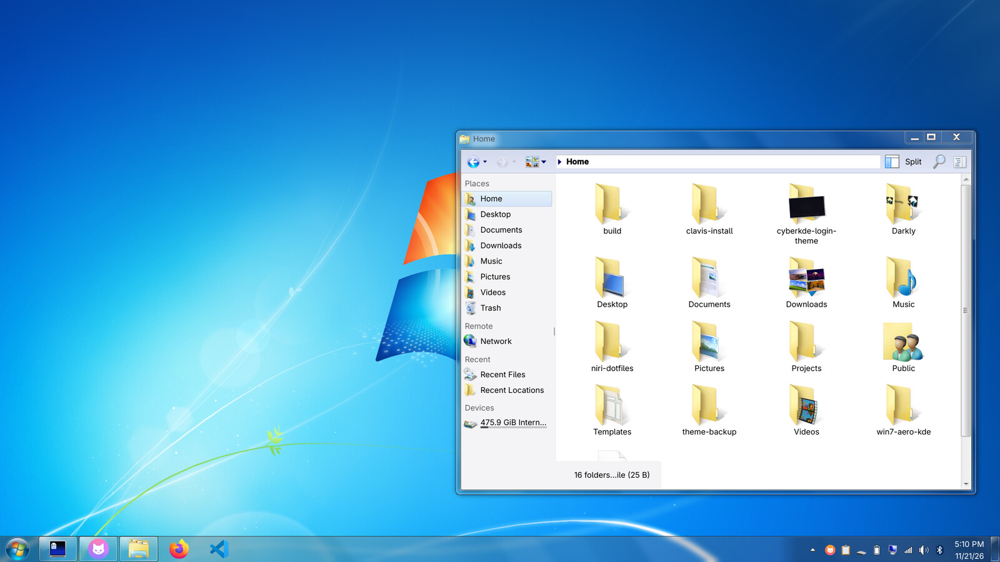

# win7-aero-kde

在 **KDE Plasma 6 + Wayland** 上复刻 **Windows 7 Aero** 外观的桌面配置。
基于 [AeroThemePlasma](https://github.com/aeroshell-desktop/aerothemeplasma)，附带可直接套用的
配置文件、修复脚本和素材，让整套效果能一条命令复现。



---

## 效果包含什么

| 组件 | 实现 |
|---|---|
| Aero 玻璃窗口 | SMOD 窗口装饰（`org.smod.smod`）+ KWin 玻璃模糊 |
| 任务栏 | SevenTasks 超级任务栏，半透明玻璃、悬停缩略图预览 |
| 开始菜单 | SevenStart（Win7 两栏式） |
| 图标 | Windows 7 Aero 图标主题（5326 个文件，拟物化） |
| 光标 | `aero-drop` 带角框的 Aero 光标 |
| 音效 | Windows 7 系统音效主题 |
| 配色 | `Aero.colors`（浅色 Aero 蓝） |
| 登录界面 | `sddm-theme-mod`（Win7 风格登录框） |
| 壁纸 | Win7 默认四色光带 + 富士山/灯塔/风车等官方风景照 |

---

## 环境要求

- **Arch Linux**（或基于 Arch 的发行版，脚本用的是 `pacman` / `yay`）
- **KDE Plasma 6.8+**（上游要求 6.8.0 / KF6 6.30 / Qt 6.11.2）
- **Wayland 会话**（ATP 从 6.8 起支持 Wayland；更早版本只有 X11）
- **SDDM** 作为显示管理器（不支持 Plasma Login Manager）
- 需要一个能装 **AUR** 的助手：`yay` 或 `paru`

---

## 快速开始

```bash
git clone https://github.com/tli317999-sudo/win7-aero-kde.git
cd win7-aero-kde
./install.sh
```

脚本会依次做：

1. 从 AUR 安装 `aerothemeplasma-desktop-git` 及其 `aeroshell-*` 组件（需 sudo，编译约十几分钟）
2. **备份**你现有的 KDE 配置到 `~/.local/state/win7-aero-kde-backup-<时间戳>/`
3. 部署图标、光标、音效到 `/usr/share`，壁纸到 `~/Pictures/wallpapers/windows7/`
4. 写入 `kdeglobals` / `kwinrc` / `dolphinrc` / `kscreenlockerrc` 等配置（自动替换家目录路径）
5. 修复 `smodglow` 效果的库路径问题（见下文「踩坑记录」）
6. 配置 SDDM 登录主题
7. 刷新图标缓存并设置壁纸

完成后 **注销**，在 SDDM 会话列表里选 **AeroThemePlasma (Wayland)** 登录，首次进入会弹设置向导。

已装过 ATP 只想套配置的话：

```bash
./install.sh --no-pkgs
```

---

## 目录结构

```
.
├── install.sh                      # 一键部署
├── configs/
│   ├── kdeglobals                  # 配色/图标/音效主题、字体
│   ├── kdedefaults-kdeglobals      # 外观默认值（Look-and-Feel 落盘的位置）
│   ├── kwinrc                      # 窗口装饰、KWin 特效开关
│   ├── dolphinrc                   # 文件管理器
│   ├── plasmarc                    # Plasma shell / 壁纸插件
│   ├── kscreenlockerrc             # 锁屏壁纸
│   ├── konsolerc                   # Konsole 配置
│   └── sddm/zzz-aerothemeplasma.conf   # SDDM 登录主题
├── color-schemes/Aero.colors       # Aero 配色方案
├── assets/
│   ├── icons/                      # Windows 7 Aero 图标 + aero-drop 光标
│   ├── sounds/                     # Windows 7 音效主题
│   └── wallpapers/                 # Win7 默认 + 官方风景壁纸
├── screenshots/
├── NOTICE.md                       # ⚠️ 素材版权声明，务必阅读
└── LICENSE                         # MIT（仅覆盖配置与脚本）
```

---

## ⚠️ 关于素材版权

`assets/` 里的图标、光标、音效、壁纸**全部是 Microsoft 的版权素材**，不属于本项目，
也不适用 MIT 许可证。本项目与 Microsoft 无任何关联。

详见 **[NOTICE.md](NOTICE.md)**。以这种形式公开再分发这些素材在多数司法辖区可能构成侵权，
请自行评估风险。

---

## 踩坑记录（本项目存在的意义）

这套配置实际调通时遇到过几个上游文档没写的问题，都已在 `install.sh` 里处理：

### 1. `smodglow` 效果加载失败

```
smodglow.so: org.smod.smod.so: cannot open shared object file
```

`smodglow.so` 的 `NEEDED` 是 `org.smod.smod.so`，而后者被安装在
`/usr/lib/qt6/plugins/org.kde.kdecoration3/`（装饰插件目录），**不在动态库搜索路径上**。
修复：软链到 `/usr/lib/`。

```bash
sudo ln -s /usr/lib/qt6/plugins/org.kde.kdecoration3/org.smod.smod.so /usr/lib/org.smod.smod.so
```

### 2. 窗口装饰改了不生效

`kwinrc` 里写好 `[org.kde.kdecoration3] theme=org.smod.smod` 后，`reconfigure` 不会重建已有窗口的装饰，
**必须重启 KWin（即重新登录）**。

### 3. `sddm.conf.d` 会读取目录里所有文件

不是只读 `*.conf`。把旧主题配置改名成 `.disabled` **无效**，必须挪出该目录；
同时自己的配置要用 `zzz-` 前缀保证字母序最后。

### 4. 应用级配置会覆盖全局图标主题

如果装过其它主题（如 CyberKDE），它可能往 `~/.config/dolphinrc` 写入：

```ini
[Icons]
Theme=CyberKDE
```

**应用级优先于全局 `kdeglobals`**，表现是「任务栏图标变了、文件管理器死活不变」。
排查时要检查各应用的 `*rc` 文件。

### 5. `kdeglobals` 里缺 `[Icons]` 段

图标主题只写在 `kdedefaults/kdeglobals` 时，`kreadconfig6` 能读到（会合并），
但 Dolphin 用的 `KIconLoader` 只读用户文件，读不到就静默回落到 `breeze`。

### 6. 已知上游缺陷（未修复）

```
kwin_effect_smodglow: SMOD RCC "smodgloweffecttextures" not found!
```

`aeroshell-kwin-components-git` 只打包了 `snapeffecttextures.smod.rcc`，
漏了 glow 的纹理资源。窗口玻璃效果正常，仅缺那层发光，需等上游补。

---

## 回滚

```bash
# 卸载 ATP
sudo pacman -Rns aerothemeplasma-desktop-git aeroshell-workspace-git \
     aeroshell-kwin-components-git aeroshell-smod-git aeroshell-libplasma-git
sudo pacman -S libplasma plasma-workspace

# 恢复配置
cp -a ~/.local/state/win7-aero-kde-backup-*/. ~/.config/
```

---

## 致谢

- [AeroThemePlasma](https://github.com/aeroshell-desktop/aerothemeplasma) — 上游主题（AGPL-3.0）
- [Frutiger Aero Archive](https://frutigeraeroarchive.org/) — Win7 壁纸存档来源

## 许可证

配置与脚本：[MIT](LICENSE)
素材：见 [NOTICE.md](NOTICE.md)（非本仓库所有）
